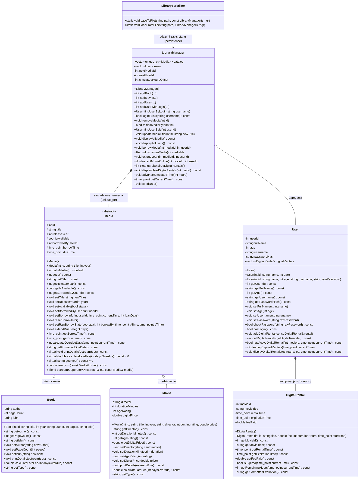

# Diagram Klas UML i Relacje w Projekcie

Poniższy diagram przedstawia architekturę obiektową Systemu Zarządzania Wypożyczalnią Mediów wzbogaconą o moduł **dystrybucji cyfrowej filmów online (VOD 48h)**, **uwierzytelnianie użytkowników z hashowaniem haseł**, **dwustronną synchronizację bazy w pliku (`LibrarySerializer`)** oraz **obsługę dwóch terminali**.

---

## Opis Relacji i Wzorców Architektonicznych

1. **Dwa Niezależne Panele Konsolowe**:
   - `library_app.exe` — interfejs administratora (CRUD mediów, użytkowników, tradycyjne wypożyczenia i zwroty z karami, symulacja upływu czasu).
   - `user_app.exe` — interfejs klienta (uwierzytelnianie, rejestracja, VOD na 48h, darmowe przedłużanie wypożyczeń o 7 dni, sprawdzanie subskrypcji).
2. **Persistence i Synchronizacja Stanu (`LibrarySerializer`)**:
   - Stan obu aplikacji synchronizowany jest w czasie rzeczywistym poprzez plik tekstowy `data/library.dat`. Każda operacja zapisu aktualizuje plik, a operacje odczytu synchronizują stan przed prezentacją.
3. **Bezpieczeństwo i Hashowanie Haseł**:
   - Klasa `User` przechowuje wyłącznie skrót hasła wyliczony algorytmem djb2.
4. **Model Czasu i Dystrybucja VOD**:
   - Automatyczne wygaszanie dostępu do wypożyczeń online po 48h oraz automatyczna kalkulacja kar za zwroty fizyczne.
